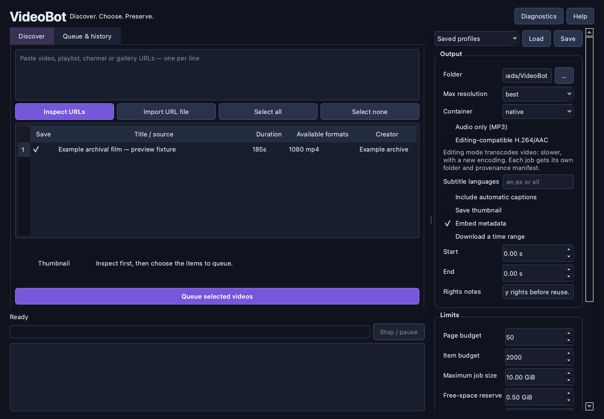

# VideoBot

**Discover media, choose what to save, and keep a reliable download library.**

VideoBot is a Python/PySide6 desktop app and headless CLI built around yt-dlp, Playwright and FFmpeg. Version 2.0 replaces the original gallery-only loop with preview and selection, a persistent queue, validated outputs and recoverable job states.

> Version 2.0 release candidate. See the [release audit](docs/RELEASE-AUDIT.md) for verification and platform status. Upstream website and authenticated-account behavior is not implied by local acceptance tests.



## Capabilities

- Inspect single video URLs, supported playlists/channels, direct media and generic HTML galleries.
- Preview titles, duration, formats when provided by the source, creator and thumbnails; select items before queuing.
- Persistent SQLite queue and history; duplicate prevention, retry failed/interrupted jobs and restart recovery.
- Real transfer progress, speed/ETA where known, plain-text bounded logs and explicit completed/failed/cancelled states.
- Strict resolution ceilings, native/MP4/WebM containers, MP3 audio, subtitle selection, thumbnails, metadata and optional time ranges.
- Editing-compatible H.264/AAC preset (transcodes and therefore takes longer).
- Job-owned temporary storage, ffprobe validation, exact output paths and atomic completed-folder publication.
- Per-video folders with provenance, SHA-256 checksums, creator/title, retrieval time and rights notes.
- Opt-in browser/cookie-file authentication for the current session; no cookies in saved profiles or exported manifests.
- Bounded discovery, size/free-space budgets, retries and a minimum five-second cooldown after successful downloads.
- Saved output profiles, URL-file import, library-manifest export and a CLI using the same engine.

## Install from source

Use **Python 3.11 or newer** (3.12 is the primary development environment).

```sh
git clone https://github.com/ShadowfetchStudio/videobot.git
cd videobot
python3 -m venv .venv
# macOS/Linux
source .venv/bin/activate
# Windows PowerShell instead: .venv\Scripts\Activate.ps1
python -m pip install -e .
python -m playwright install chromium
```

Install **FFmpeg and ffprobe** and put them on PATH:

- macOS: `brew install ffmpeg`
- Debian/Ubuntu: `sudo apt install ffmpeg`
- Windows: install a trusted FFmpeg build; verify `ffmpeg -version` and `ffprobe -version` from a fresh terminal. `winget search ffmpeg` lists available packages.

Full YouTube support also needs a supported JavaScript runtime. Install [Deno](https://docs.deno.com/runtime/getting_started/installation/) or a current Node.js release. The Python installation includes `yt-dlp[default]` and its EJS dependency. VideoBot detects Deno first, then Node. See [yt-dlp's current requirements](https://github.com/yt-dlp/yt-dlp#dependencies).

```sh
videobot doctor
videobot-desktop
# Or: python run.py
```

For reproducible development, see [development and packaging](docs/DEVELOPMENT.md). The original `VideoBot.app` in the checkout remains a source launcher: it is **not** the new self-contained Python/Qt build. Keep that launcher beside `run.py`; its environment must still be installed.

## Desktop workflow

1. Paste one URL per line and click **Inspect URLs**. Discovery does not download the full videos.
2. Review the candidate list and select the items you want. Playlist entries may not have format/size metadata until extraction; unknown values are shown honestly.
3. Choose destination/output options and click **Queue selected videos**.
4. Open **Queue & history**, then **Run queue**.
5. Use **Stop / pause** to end the current run. Select interrupted jobs and **Retry selected** to requeue them; already queued jobs remain queued.
6. Use **Open output** for a completed bundle or **Export manifest** for your research library.

Authentication choices are session-only. Choose the needed browser or cookie file again when running authenticated queued jobs after a restart. Changing settings does not silently rewrite already queued jobs.

## Outputs and preservation

Each completed job is published as `VideoBot-<job-id>/` under the chosen destination. The folder contains the final media, requested sidecars and `manifest.json`. A hidden `.videobot-staging/` directory holds unfinished job files; interrupted work never appears as a completed final folder. Do not delete staging files while a job is running.

VideoBot checks real media streams instead of rejecting valid clips based on file size. It does not delete pre-existing user files. Removing queue records does not remove media. Query parameters are redacted from exported source URLs to avoid leaking signed credentials; the private queue retains URLs needed for retry. Rights notes default to **unknown** and should be checked before reuse.

## Headless CLI

```sh
videobot inspect "https://example.com/videos"
videobot add "https://example.com/video.mp4" --destination "/path/to/library" --quality 1080 --container mp4
videobot list
videobot run
videobot retry JOB_ID
videobot run --cookie-browser firefox
```

Use `videobot --db /path/to/queue.sqlite3 ...` for an alternate queue. Set `VIDEOBOT_HOME` to relocate application data. CLI inspection emits JSON events suitable for automation. Source URLs and account access must be authorized by the user running the app.

## Important limits

- A strict height ceiling fails if no suitable format exists. It never silently downloads a larger video. MP4/WebM remux can fail for incompatible codecs; choose native or the editing-compatible preset as appropriate.
- Stop interrupts the supervised desktop worker; a short grace period allows cleanup before process-tree termination.
- yt-dlp downloads can resume when supported. Raw HTTP transfers restart safely instead of appending to a possibly changed resource.
- Generic web crawling stays on the listing origin for navigation and uses page/item/scroll budgets. A warning identifies truncated discovery. Dynamic sites may require a dedicated extractor or manual input.
- Subtitle/thumbnail availability depends on the source. Cookie access can require OS permission and does not bypass account restrictions or DRM.
- Stream-copy time ranges can align to keyframes; they are not frame-accurate edits. Editing conversion changes the encoding.
- See [troubleshooting](docs/TROUBLESHOOTING.md), [architecture](docs/ARCHITECTURE.md), [changelog](CHANGELOG.md) and [security](SECURITY.md).

## Contributing

Read [CONTRIBUTING.md](CONTRIBUTING.md). Reproduction fixtures should be local/generated and must not contain account cookies or signed URLs. Changes to the downloader should include failure-path tests, not only a successful transfer.

[Support ShadowfetchStudio](https://www.buymeacoffee.com/shadowfetcu) · [Report a bug](https://github.com/ShadowfetchStudio/videobot/issues)
